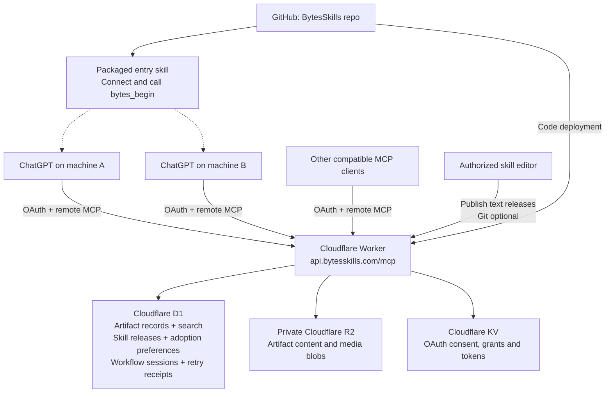

# BytesSkills — concise product and infrastructure PRD

**Release:** plugin/library 0.7.0 · service 0.2.0

**Purpose:** use consistent content workflows and the same saved work from different AI chats and machines, without requiring Git.

## Experience

The user selects BytesSkills and types commands such as `/bytes brainstorm`, `/bytes refine`, or `/bytes clip`. The AI interprets the request, asks for missing creative inputs, and uses the API to persist results. These are assistant-facing commands, not native terminal or ChatGPT slash commands.

Skills define how to work. Formats define a content structure. Treatments define presentation choices. Artifacts are the concepts, hooks, scripts, plans, and media produced. These are distinct: updating a skill changes future work, not previously saved artifacts.

## Architecture

**Cloudflare is the live source of truth.** GitHub stores core code, schemas, packaged skills and release sources. It is not required for everyday work or personal skill publication. The current source tree excludes workspace snapshots. Older Git commits still retain previously committed data; this change does not rewrite history.

D1 stores structured records and relationships. R2 stores their actual content. A pointer such as `@concept/<UUID>:v2` resolves through D1 to a precise, immutable artifact revision and its content hash. Unversioned pointers resolve to the latest revision. Revisions and alternative candidates stay separate.

## Skill lifecycle

1. **Publish:** an authorized editor publishes a new immutable skill version with a summary and complete resource snapshot. Existing versions cannot be overwritten.
2. **Check:** execution/help/sync requests call `bytes_begin`; artifact reads use get/query/history/related directly and private authoring uses `bytes_author`. It compares the workspace's selected version with the latest published release.
3. **Choose:** offer **Update**, **Stay**, or **Always latest**. Remember the choice per skill, per workspace, across machines. Stay suppresses that offered version; a later release can prompt again.
4. **Run:** return pinned instructions and a workflow ID. The workflow retains that version even if another machine updates the library.
5. **Save:** require the workflow ID for MCP artifact writes and stamp the skill version/checksum on the artifact. Reject missing, expired or revoked workflows.

`/bytes sync --check` previews changes. `/bytes sync --latest` adopts the current library atomically without asking per skill or changing future update preferences. `/bytes sync --git` is the separate local Git workflow. A changed catalog or preference state invalidates an adoption preview, preventing concurrent overwrites.

## Security and reliability

- OAuth separates read, write and skill-publication permissions. Auto updates never expand permissions.
- Skill instructions are text; the service does not execute uploaded code. Artifact content is not implicitly trusted as instructions.
- Immutable releases have server-computed hashes; artifacts have immutable revision chains. Writes use retry IDs and concurrency checks.
- Private blobs require authenticated access. Credentials stay outside Git and plugin packages.
- Administrators can revoke a release. Active workflows expire after 24 hours.
- Publication, adoption and artifact history are separate, allowing instruction updates without rewriting creative work.

## Delivery boundaries and next steps

This deployment serves **one private workspace**, not separate public customer accounts. The seven versioned workflows are help, brainstorm, refine, inspect, organize, clip and sync. Adding new command families still requires a code/tooling release.

Existing custom MCP connections require one refresh for this protocol. Later instruction-only releases are fetched remotely. The server cannot force an AI to invoke tools, push into idle chats, or prove that the model followed every instruction. It can enforce version provenance on saves. Host routing should be tested with @BytesSkills selected.

Media editing depends on connected tools; this service does not render videos. The MVP upload cap is 10 MB. Automatic backups and public multi-user onboarding remain future work. Recovery needs authoritative D1 tables and R2 blobs; the FTS search index is rebuilt separately. Legacy artifact exports alone do not back up skill-adoption state.

**Acceptance:** publish on one machine, see an update on another; keep/update decisions persist; bulk adoption is atomic; running work stays pinned; missing permissions, stale previews and invalid workflow saves are rejected. Integration tests cover these behaviors; the other ChatGPT instance still needs host-level refresh and verification.
