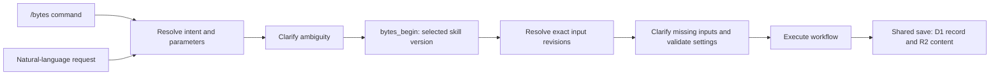

# Extending BytesSkills consistently

One public language, one workflow contract, one pointer system. A natural-language
request and its `/bytes` equivalent must resolve to the same operation, required
inputs, permissions, pinned definitions and save behavior.

## Pick the right extension

| Addition | What it defines | What it must not invent |
| --- | --- | --- |
| Skill | An operation: inputs, procedure, capabilities, outputs and failure behavior | Its own IDs, storage or version-adoption protocol |
| Format | Editorial promise, required inputs, structure, inheritance and review rules | A separate command for every format |
| Treatment | Presentation defaults such as captions, music, SFX or animation | The central idea or editorial structure |
| Object profile | A named, versioned shape on an existing artifact type | A new top-level pointer prefix merely for convenience |
| Fundamental artifact type | New persistence or relationship semantics | A registry-only change that ignores database constraints |

For example, a future episode planning skill could save a `plan` using an episode
profile. It would still have `@plan/<UUID>:vN`. Its format might be reductions; its
presentation treatment might be restrained narrator. These are separate choices.
This example is not an installed episode skill or a newly created user artifact.

## Current implementation versus next steps

Implemented on this branch:

- `contracts/runtime.json` drives server command routing, available skill IDs,
  save permissions, release packaging and local/cloud artifact type lists.
- `npm run check:library` checks routes, operation input/output types, handler files,
  format shape, format inheritance, workflow/treatment references and SQL type parity.
- Authoring templates and validation cover skill contracts and object profiles.
- The routing reference instructs the assistant how to normalize ordinary language;
  the server continues to accept canonical `/bytes` commands. This is not an NLP
  parser, and host routing still depends on the connected assistant selecting BytesSkills.
- Release candidates require an explicit version and refuse to overwrite an existing
  candidate. Previously published releases and saved artifacts are unchanged.

Not implemented: a conversational authoring/admin command, automatic profile field
validation on `bytes_save`, automatic inheritance resolution, or dynamically adding
new command families without deploying the server. Draft contracts are not activated
by writing a file. The library checks validate declared structure, not editorial truth.

## The authoring conversation

Start by asking what the new thing should do and one example input/output. Classify
it using the table above, then ask only unresolved applicable questions, one at a time:

1. What should trigger it, and what similar requests should not trigger it?
2. What inputs or pointers are required? Which values can inherit? What does “idk”
   delegate, and which inputs cannot be safely invented?
3. What does it produce? New candidates or revisions of an existing object?
4. Which formats, profiles and capabilities does it need? What happens if a tool or
   required source is unavailable?
5. What makes the result acceptable? What should happen on partial failure?

Produce a reviewable draft contract and instruction file. A discussion or draft is
not a publication. Source changes follow normal branch/test/review flow. Personal
future authoring should publish immutable definitions to the cloud, without requiring
user Git; the current cloud publisher supports releases for registered skill families.

## Add a skill

Use [skill contract v2](skill-contract.md) and the updated template. It separates
flags from conversational intake and declares typed deliverables, capability limits,
failure behavior and shared response rules. CI validates source contracts; it does
not grant runtime permissions or validate generated file contents.

Copy `templates/extensions/skill.json` into `definitions/skills/<id>.json`, fill it
in and create the handler in the bytes skill's references directory. Use the generic
SKILL template for instruction structure, but keep `/bytes` as the public entry point.

For a new command family, add its registry entry and matching operation entry in
`contracts/operations.json`. Declare write permission explicitly; do not gain it by
merely supplying a release with a write scope. Add help, examples and tests. This
requires a Worker deployment before publishing the new family's first skill release.
A procedure update within an existing family only needs a new compatible release.

All skill results inherit the shared `references/responses.md` contract; the release
builder embeds it automatically. Include real IDs and individually copyable next
commands in save/list responses, and distinguish draft definition IDs from artifacts.

Every parameter declares type, requiredness, clarification question and delegation
policy. A pointer field declares allowed artifact types. Unknown flags are errors;
a natural-language phrase must never create a new flag or silently broaden scope.
Keep settled inherited answers and preserve explicit setting precedence.

## Add a format

Copy `templates/extensions/format.json` to `definitions/formats/<id>.json`. Supply
real workflow and treatment IDs, editorial structure and checks. A single optional
`extends` points to another format ID; folder nesting has no inheritance meaning.
The checker rejects missing parents and cycles. Context resolution remains the
assistant's responsibility under the system specification.

Bundle the format into a new release of every skill that uses it. Existing workflows
remain pinned to their original resources; they must not mix a newer format from
live discovery into an older skill run. Record the definition version actually used.
Test both explicit `--format=<id>` and natural-language selection.

## Add an object profile

Copy `templates/extensions/object-profile.json` to `definitions/object-profiles/<id>.json`.
Select an existing `base_type`. Declare typed fields, requiredness and pointer targets.
This is a versioned authoring contract; it does not create a database table or tool.

Proposed representation, pending runtime enforcement:

- Standard artifact identity, title, status, content and relationships stay unchanged.
- `settings.object_profile` identifies `{id, version}`.
- `settings.fields` holds the profile's structured values.
- Pointer field values must also appear as exact references in `relations.inputs`
  or `links`, so existing reverse-reference queries can find them.
- Keep narrative/media content in the normal content blob. Add a profile tag for
  current tag filtering; arbitrary profile-field search is not implemented.

Before activating a profile, implement server-side field validation, pin its schema
in the skill release, validate on both creation and refinement, and test migration
behavior. The template checker alone cannot make `bytes_save` enforce those fields.
Adding required fields or changing meanings requires a new profile version and an
explicit migration path; old records continue to use their original schema.

If no base type fits, add a fundamental type only with a migration, pointer/query/
import/export compatibility work, local runtime support and tests. The current SQL
parity check deliberately blocks a registry-only type addition; update the check to
validate the migrated schema as part of that work. Existing migrations are immutable.

## Release and adoption

1. Validate contracts, typecheck, build, and test the affected behavior.
2. Review the source changes. Deploy only if routing, capabilities or runtime changed.
3. Build an explicit NEW release version with `node scripts/build-release.mjs VERSION`.
   This refreshes the bundled library, pins definitions and includes handlers.
   Large libraries must use `node scripts/build-release.mjs VERSION OUTPUT SKILL`
   to build separate candidates within the server's 250 KB batch limit. Publish all
   intended candidates before bulk adoption; separate publications are not atomic.
   Failed publication must be resumed and verified before declaring the library ready.
4. Publish through the authorized release publisher, then use the existing Update /
   Stay / Always latest flow or `/bytes sync --latest` for adoption.
5. On a second device, run both request styles and confirm the skill checksum,
   definition versions and saved pointer provenance match the intended release.

A Git merge, Worker deployment, release publication and workspace adoption are four
separate events. No step should claim the next one happened automatically.

## Acceptance cases for every addition

- Equivalent command and natural-language requests choose the same workflow and inputs.
- Ambiguous intent asks first; a how-to question remains read-only.
- Missing inputs clarify; “idk” delegates only eligible fields.
- Unknown flags, incompatible types and broken pointers are surfaced without a save.
- Inheritance and explicit overrides follow the same rules in both request styles.
- A generation creates new IDs; a refinement preserves identity and appends a revision.
- Retries reuse request IDs; concurrent edits reject stale revisions; partial results survive.
- Unavailable tools and failed uploads never produce false completion claims.
- Old and new skill versions coexist; another device sees the chosen adoption state.
- Definition/profile changes do not silently alter saved artifacts or running workflows.
