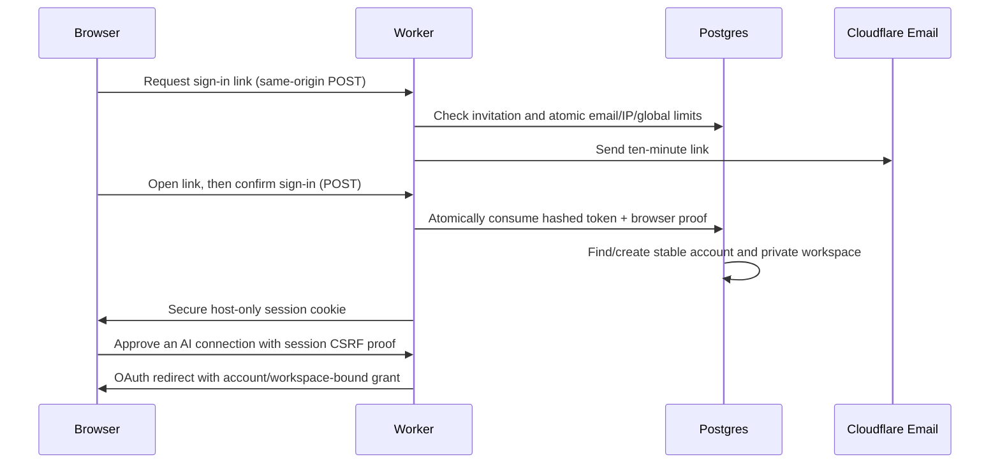

# Magic-link login and the second-user pilot

The Worker implements invite-only email login using Cloudflare Email Service and
PlanetScale PostgreSQL. It does not depend on a separate identity provider or a
PostgreSQL authentication extension. Migration `0002_magic_link_login.sql` is additive.

## Security and behavior

- Links contain 256 random bits; only their SHA-256 hashes are stored. Each is bound
  to a ten-minute browser nonce and the requesting origin. Opening the email in a
  different browser requires a new link. GET previews never consume tokens.
- Invites are explicit database entries. Responses do not disclose invitation status.
  Atomic fixed-window limits are three requests per email, twenty per IP and 200
  globally per fifteen minutes. Provider sending quotas also apply.
- Sessions last seven days, store only hashes, and use Secure, HttpOnly, SameSite=Lax,
  host-only cookies. App and API origins have independent cookies: connecting an AI
  may require signing in again on the API origin. We do not share cookies with all
  subdomains. Sessions recheck account and membership status on every request.
- All state-changing browser routes require the exact Origin. Session actions and
  consent additionally require a session-derived CSRF value. Return paths are
  restricted to `/app` or the local OAuth consent route.
- Email is normalized to lower case as an explicit v1 identity policy; aliases and
  plus addresses are not collapsed. Accounts retain stable internal UUIDs. Legacy
  data is never assigned by matching email or signup order. On the first login,
  the original owner can provide the existing owner key to claim that workspace.
  Claims are serialized and cannot overwrite an existing identity or owner.
- The identity connection has function execution privileges, not direct table
  access. Runtime and publisher credentials cannot read login tokens or sessions.
  All four authentication tables have FORCE RLS and a schema-owner policy.
- Authenticated users can grant read/write and refresh access, never publish core
  skills. Existing signed legacy grants remain confined to the original workspace.
  Browser logout revokes that session; AI connections are revoked separately.
- OAuth grants still use the provider's Cloudflare KV storage. Cross-edge visibility
  and revocation can be delayed. PostgreSQL account/membership disablement is checked
  independently. Do not promise immediate global OAuth revocation until grant storage
  has a strongly consistent implementation.

## Rollout

Configure `APP_URL=https://app.bytesskills.com`, the app custom-domain route,
`EMAIL_FROM=login@auth.bytesskills.com`, an EMAIL send binding, and a separate
IDENTITY_DB Hyperdrive using `bytes_identity` (cache disabled, five connections).
Apply the additive migration with the schema administrator before enabling
`LOGIN_ENABLED=true`. Missing configuration must never fall back to public signup.
The existing API domain remains the OAuth issuer and MCP endpoint.

Use `BYTES_POSTGRES_ADMIN_URL` securely with `node scripts/invite.mjs EMAIL` from
`service/` to invite a pilot user. `--disable` prevents future email logins; disable
an account or revoke sessions separately to stop existing access. Never commit
emails, invitation records, tokens, credentials or workspace exports.

Before rollout: CI must pass the PostgreSQL and full Worker/OAuth tests. After
rollout: the owner signs in and claims the original workspace; a second invited
person signs in independently and authorizes an AI. Verify each user's artifacts
from another device, plus cross-account pointer, file, history and grant denial.
Do not enable general signup before that pilot is complete.

## CI and email reports

The Source boundary workflow runs service checks/build, compatibility tests, and a
real PostgreSQL 17 suite. The suite covers token races/replay/expiry, browser binding,
invites, rate limits, logout, CSRF, ownership claims, and full Worker login→consent→
OAuth→MCP isolation. CI captures synthetic login emails; it never redeems a real
person's login link. Live magic-link redemption remains a human pilot check.

One result email is sent for every trusted Source boundary workflow run, including
failures. Fork PRs have no sender secret. The separate `infra/ci-email` Worker accepts
only fixed-format reports to an operator-configured recipient. It has no database,
R2, OAuth or deployment credentials. GitHub holds only its narrowly scoped invocation
key (`BYTES_CI_NOTIFY_KEY`). Recipient and key hash are Worker secrets. The notification
job checks out no code and does not execute test artifacts. Cloudflare acceptance
confirms queuing, not inbox delivery. A notification failure is visible as a failed job.
