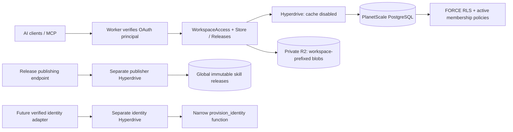

# PostgreSQL / PlanetScale migration

Status: implementation on `codex/multi-user-foundation`; provisioning and production
cutover are pending. D1 remains authoritative until the procedure below completes.
The PostgreSQL integration tests run against a disposable PostgreSQL 17 server in
GitHub Actions. No database credentials or workspace snapshots belong in Git.

## Architecture and isolation

`bytes_runtime` is a non-owner, NOSUPERUSER/NOCREATEROLE/NOBYPASSRLS login.
All 14 tenant/identity tables have ENABLE and FORCE ROW LEVEL SECURITY. Runtime
reads identity status/membership only for its authenticated account; it cannot
create/edit identities or memberships. Every tenant data policy checks the selected
workspace, account status and active membership. Missing/mismatched context sees
no tenant rows. Writes to another workspace fail. Composite foreign keys remain
as a second defense for relations and workflow provenance.

The Worker sets account/workspace with transaction-local `set_config(..., true)`
on the same client as the queries. Commit/rollback clears that context. It never
uses session-level identity or shares an application client across requests.
Hyperdrive query caching MUST be disabled: cached private queries cannot substitute
for an authorization check or read-after-write consistency.

The adapter opens a short transaction per database operation, with a workspace
advisory lock for mutations. Artifact revision/head/index writes remain one atomic
batch. Publication serializes with adoption writes, and a narrow definer trigger
invalidates adoption previews without exposing workspace content to the publisher.

`bytes_publisher` can only read/insert global releases and revocations.
`bytes_identity` can only execute the verified-identity provisioning function; it
cannot query artifacts or directly change accounts. Do not bind IDENTITY_DB until
the trusted login adapter is ready. The schema administrator owns migrations and
narrow definer functions; it must never be a Worker binding. No runtime role is
made a member of the administrator role. Definer functions fix search_path,
including pg_temp last, and PUBLIC execute is revoked.

RLS protects against missed application filters. It does not make a compromised
Worker safe: the Worker is trusted to supply the authenticated principal. R2 also
still relies on the trusted Worker and workspace-prefixed keys; PostgreSQL RLS
cannot enforce object-store access. R2 stays private with no public bucket or
user-facing bucket credential.

## Provisioning (not completed)

1. Link PlanetScale through Cloudflare Hyperdrive or authenticate the PlanetScale
   CLI. Choose PostgreSQL, not Vitess, and the smallest suitable single-node tier;
   confirm the actual price/region shown by the provider. This is a pilot with no
   HA claim. Create a dedicated BytesSkills database and a schema administrator.
2. Run `node scripts/postgres-migrate.mjs` from `service/` with
   `BYTES_POSTGRES_ADMIN_URL` supplied securely. Remote URLs must use
   `sslmode=verify-full`. The checksummed migration ledger makes repeats safe and
   refuses altered applied migrations. Initial application roles are NOLOGIN and
   have no password; enable login/set generated passwords through the administrator
   or provider role management without adding broader inherited roles.
3. Create separate Hyperdrive configurations for `bytes_runtime` and
   `bytes_publisher`, explicitly `caching.disabled=true`, starting with a small
   origin connection limit (5). Verify their roles, TLS origin configuration and
   available connections. Do not use PlanetScale's default privileged credential.
4. Run `node scripts/postgres-config.mjs RUNTIME_ID PUBLISHER_ID` and review/commit
   the resulting config. It removes the core D1 binding, adds the Hyperdrives and
   sets STORAGE_BACKEND=postgres. There is no fallback if PostgreSQL is unavailable.
   The website Worker and its separate waitlist D1 database remain unchanged.
5. Put the separate migration administrator URL in the protected GitHub production
   environment as `BYTES_POSTGRES_ADMIN_URL`. Limit who may run production jobs.
   No schema administrator credential is present in the deployed Worker. Runtime
   credentials live in Hyperdrive. Future additive PostgreSQL migrations run using
   this secret, with source/manifest checksum verification.

## Rehearsal and cutover

Keep D1 and its old deployment available. Do not apply D1 0004/0005 as a prerequisite
for PostgreSQL: the transfer supports the deployed legacy layout directly. Those
migrations remain only for the D1 compatibility tests and recovery reference.

Before production, rehearse on an isolated database. CI verifies the real runtime
against PostgreSQL, including legacy import, missing filters, cross-tenant reads,
writes/links, connection reuse, concurrent identities/revisions, revocation,
publication permissions, adoption/workflow separation, and immutable checksums.
Add a Cloudflare staging smoke test using the actual restricted Hyperdrives before
switching production; local/CI PostgreSQL alone does not prove origin connectivity.

For the final cutover:

1. Record the exact previous Worker deployment/version, bindings and secrets.
   Deploy `src/maintenance.ts` with the **old D1 configuration** and existing
   routes/KV/R2: from service/, run
   `npx wrangler deploy --config wrangler.d1-recovery.jsonc`.
   This separate configuration retains the original D1 binding for export even
   after the main config switches to PostgreSQL. It denies all application routes with 503 and Retry-After, and
   `/health` reports `status=maintenance,writes_paused=true`. Wait for old in-flight
   requests to finish before taking the final snapshot; verify the gate from
   multiple connections. Do not leave another writer running against D1.
2. From service/, run `node scripts/postgres-transfer.mjs export /private/path/snapshot.json`.
   The script checks the maintenance gate before/after export, uses explicit table
   names, and writes mode 0600 outside Git. Snapshot accounts for legacy records,
   heads, relations, search, requests, releases, adoption decisions and sessions.
   Any historical core website_waitlist rows are outside the workspace transfer;
   retain D1 or export them separately if needed.
3. Run `node scripts/postgres-verify-blobs.mjs /private/path/snapshot.json` to read
   and hash each referenced R2 object through Wrangler while the API is paused.
   It does not change R2 keys or content.
4. Run `node scripts/postgres-transfer.mjs import /private/path/snapshot.json`
   against the empty migrated database. This preserves raw canonical JSON text,
   hashes, pointers, revision history and D1 rowid export boundaries. It validates
   record/release checksums and exact table contents before committing, with all
   foreign keys enforced. Nonempty targets are rejected. Import trigger changes
   are transactional and restored before commit. Repeat with `verify` to compare
   every stored field to the snapshot.
5. Verify actual runtime role attributes, schema ownership, all RLS flags/policies,
   Hyperdrive cache disabled, and cross-tenant behavior through staging. Deploy the
   reviewed prepared production Worker with PostgreSQL bindings. Do not publish an
   ordinary release to perform this initial storage switch: its preflight blocks it.
6. Verify owner reconnect, MCP begin/updates/get/query/save, workflow provenance,
   blob downloads and a revision round-trip. Exercise two verified test principals
   against the production storage layer before enabling a real second-user login.
   Check runtime logs for errors without logging SQL parameters/records. Health's
   `postgres-rls-v1` is a code contract, not proof that these checks passed.
7. Keep D1 read-only as a recovery source and retain the private snapshot according
   to an explicit retention policy. Only then resume ordinary GitHub releases.

Before PostgreSQL accepts new writes, recovery can redeploy the recorded D1 Worker
with its old config. **After new PostgreSQL writes, do not switch back to D1**:
that would discard new state. Pause writes and repair forward, or perform a separately
verified reverse transfer. Release automation explicitly refuses a stale D1 rollback.

## Remaining milestone work

This does not implement login, legacy-owner claim, multi-user consent, the dashboard
or external second-user onboarding. The existing signed owner grants stay restricted
to the legacy workspace while it is unclaimed. The next phase verifies a managed
identity, provisions an account through the restricted function, and binds OAuth
consent/grants to that identity. That phase must retain this RLS boundary.
